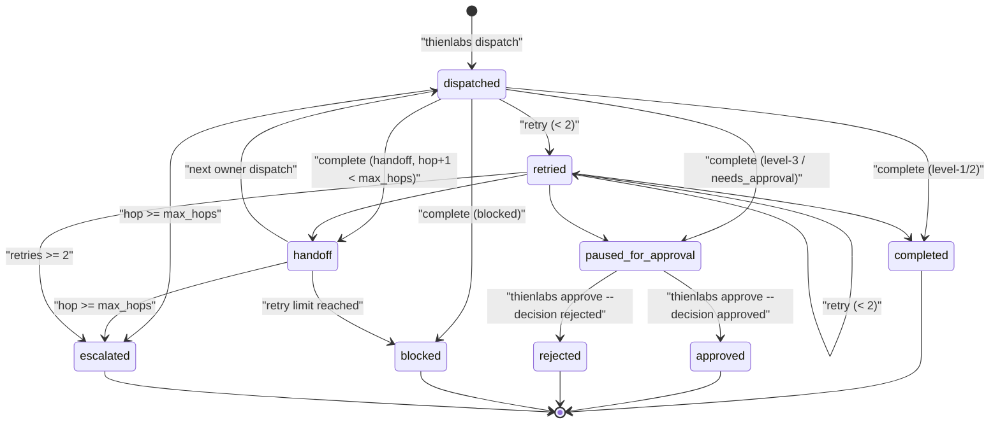

# ThienLabs Workflow & CLI Feature Map

Canonical reference for agents and operators interacting with the `thienlabs` runtime (`node dist/cli.js`).

## CLI Commands

| Command | Purpose | Key Flags | Output / Side Effect |
|---|---|---|---|
| `validate` | Verify YAML frontmatter, links, isolation, `src/` DAG, and zero-workaround rules | `--json` | Exit `0` on pass; `1` with actionable `[CODE]` diagnostics on failure |
| `build-context` | Assemble bounded, classification-filtered context envelope | `--project`, `--agent`, `--brief`, `--max-files`, `--max-chars` | JSON `{ loaded_files, skipped }` |
| `init-project` | Scaffold a new `projects/<id>/` unit and register it | `--id`, `--name`, `--dry-run` | Creates 9 files + updates `project-registry.md` |
| `dispatch` | Validate circuit breakers, build prompt, and record `dispatched` | `--brief`, `--dry-run` | JSON prompt payload + `runtime/ledger.jsonl` |
| `complete` | Validate `ExecutionResult`, handle `handoff` or Level 3 `APR-*` gate | `--brief`, `--result` | Records `completed`, `handoff`, `paused_for_approval`, or `blocked` |
| `retry` | Classify transient failure (`provider\|tool\|permission\|context\|ambiguity`) | `--brief`, `--failure-class`, `--summary` | Records `retried` or `escalated` at `retry_count >= 2` |
| `approve` | Record Director decision on a paused Level 3 task | `--task`, `--decision`, `--notes` | Updates `APR-*.md` + appends `approved` / `rejected` |
| `status` | Inspect latest task states in `runtime/ledger.jsonl` | `--project`, `--task` | JSON array of latest `LedgerEvent` per task |

## Canonical Task & Approval Statechart

